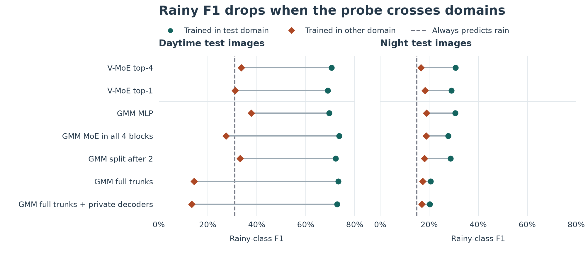
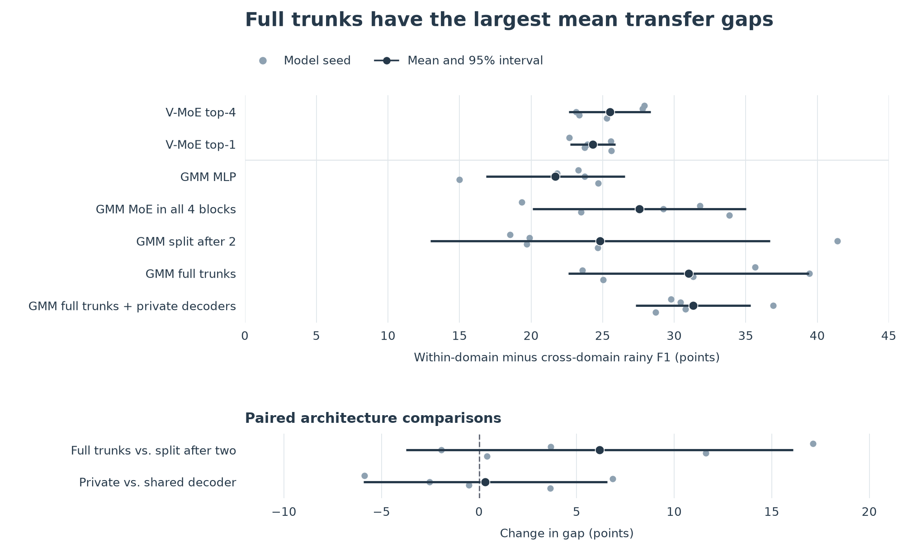
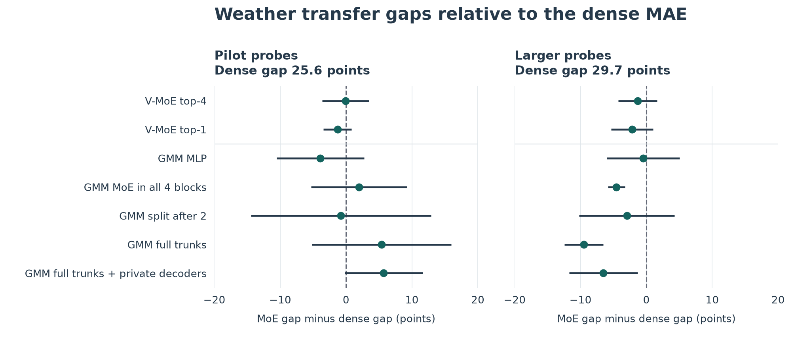

# M6.4.0 Day–night weather probe transfer

Does a linear classifier for rainy versus clear weather transfer between daytime and nighttime images, and does the
transfer gap increase with expert isolation? This experiment uses the final checkpoints from all six
[M6.3.0 variants](M6.3.0-day-night-forgetting.md) and the M6.3.1 ablation that routes MLPs in all four blocks. Each
variant contributes the same five model seeds. All probes use one fixed image split shared across variants and seeds.

## Protocol

Use `clear` and `rainy` labels from the official BDD100K validation images. The pool contains 1,764 clear and 396 rainy
daytime images and 3,274 clear and 286 rainy night images. Hold out a stratified 30% by time of day and weather using
split seed 640. Downsample the training pool to 200 images per weather class and domain. Test sets retain their original
class prevalence.

| Test set | Clear | Rainy | Always-clear accuracy | Always-clear rainy F1 |
| -- | -: | -: | -: | -: |
| Daytime | 529 | 119 | 81.6% | 0.0% |
| Night | 982 | 86 | 91.9% | 0.0% |

Extract one frozen 96-dimensional mean-pooled patch embedding per unmasked 64×64 image. Learned gates use their usual
inference routing. Fixed gates use the saved GMM posterior. For each trunk variant, including the private decoders,
`encode` returns the posterior-weighted encoder embedding. In the private-decoder model this is a readout for
evaluation, because the reconstruction loss mixes decoder predictions. The cached GMM was fit on all BDD100K splits,
including the validation images. These results measure probe transfer under the existing offline routing setup.

Fit two L2-regularized logistic classifiers (`C=1`) per checkpoint, one on daytime and one on night training examples.
Fit feature standardization on each classifier's training examples. Score each classifier on both held-out domains.
Report accuracy, balanced accuracy (mean of the two class recalls) and F1 for the rainy class. The transfer gap is the
mean of the two within-domain scores minus the mean of the two cross-domain scores. The score on each test domain has
equal weight. Report means and descriptive 95% Student-t intervals over the five model seeds. These intervals describe
seed variation for this fixed probe split.

## Results

All 35 final checkpoints completed at update 963. The within-domain probe had higher rainy F1 on daytime images in all
35 runs and on night images in 33 runs.



**Figure 1.** Each row compares two probes on the same test images. The dashed line marks the F1 from always predicting
rain, 31.0% on daytime images and 14.9% at night. Day → night probes beat the night baseline by only 1.7–4.0 percentage
points. In the opposite direction, the V-MoE night probes predicted rain on 88–92% of daytime test images, compared with
18% labeled rainy.

Each table cell gives mean accuracy / rainy F1 in percent. The rightmost column gives the rainy F1 transfer gap in
percentage points with its descriptive 95% interval.

| Variant | Day → day | Day → night | Night → day | Night → night | Rainy F1 gap |
| -- | -: | -: | -: | -: | -: |
| V-MoE top-4 | 86.9 / 70.5 | 65.5 / 16.6 | 28.7 / 33.6 | 73.5 / 30.7 | 25.5 [22.6, 28.3] |
| V-MoE top-1 | 85.9 / 68.9 | 70.0 / 18.2 | 23.8 / 31.2 | 71.9 / 29.1 | 24.3 [22.7, 25.9] |
| GMM MLP | 86.2 / 69.5 | 69.3 / 18.9 | 65.6 / 37.8 | 73.5 / 30.6 | 21.7 [16.9, 26.5] |
| GMM full trunks | 88.4 / 73.2 | 67.6 / 17.4 | 58.6 / 14.4 | 62.3 / 20.6 | 31.0 [22.6, 39.4] |
| GMM split after two | 87.6 / 72.2 | 75.6 / 18.0 | 69.6 / 33.2 | 71.3 / 28.7 | 24.8 [13.0, 36.7] |
| GMM full trunks + private decoders | 88.1 / 72.8 | 75.0 / 16.9 | 60.3 / 13.4 | 61.4 / 20.1 | 31.3 [27.3, 35.3] |
| GMM MoE in all four blocks | 88.5 / 73.6 | 63.3 / 18.8 | 61.9 / 27.5 | 70.7 / 27.7 | 27.6 [20.1, 35.0] |

Night → night rainy F1 was 20.1–30.7% across the seven variants, so the night transfer results start from a weaker
within-domain baseline.



**Figure 2.** Larger gaps mean within-domain probes outperform transferred probes by more. Each small dot is a model
seed. In the bottom panel, differences are taken within seed before estimating the mean and interval.

Compared with sharing the first two blocks, the full-trunk model with a shared decoder increased the gap by 6.2 points
(paired 95% interval [−3.7, 16.1]). Adding private decoders to full trunks changed the gap by +0.3 points (paired
interval [−5.9, 6.6]). Both intervals span zero, so the effect of increasing architectural isolation remains uncertain.
Each transfer test changes illumination and other characteristics of the input images along with the distribution of
router outputs.

## Follow-up with 2,000 training images per class and domain

Sample 2,000 clear and 2,000 rainy images per domain from the M6.3 encoder training cache with seed 640. Each probe fits
on 4,000 images, ten times the pilot size. Use the same 35 final checkpoints, probe settings, and 1,716 held-out
validation images as the pilot. The test comparison is paired by checkpoint. The pool used to fit the probes also
changes from BDD validation to BDD training, so the comparison combines the change in sample size and source split.

Each cell gives mean accuracy / rainy F1 in percent. The last column shows the pilot and follow-up mean F1 transfer gaps
in percentage points.

| Variant | Day → day | Day → night | Night → day | Night → night | F1 gap, pilot → follow-up |
| -- | -: | -: | -: | -: | -: |
| V-MoE top-4 | 90.3 / 77.3 | 54.3 / 18.8 | 34.5 / 33.6 | 73.9 / 31.9 | 25.5 → 28.4 |
| V-MoE top-1 | 89.7 / 76.0 | 56.5 / 19.6 | 28.1 / 31.1 | 71.8 / 29.9 | 24.3 → 27.6 |
| GMM MLP | 90.2 / 77.0 | 54.2 / 18.0 | 41.3 / 33.5 | 74.2 / 32.9 | 21.7 → 29.2 |
| GMM full trunks | 89.4 / 75.4 | 55.5 / 19.9 | 52.8 / 39.0 | 64.6 / 23.9 | 31.0 → 20.2 |
| GMM split after two | 90.2 / 77.0 | 58.2 / 18.6 | 37.1 / 36.1 | 73.3 / 31.2 | 24.8 → 26.8 |
| GMM full trunks + private decoders | 89.6 / 75.8 | 51.3 / 17.8 | 40.2 / 35.7 | 66.1 / 24.0 | 31.3 → 23.2 |
| GMM MoE in all four blocks | 91.1 / 78.9 | 55.7 / 20.0 | 45.4 / 38.5 | 72.4 / 30.0 | 27.6 → 25.2 |

Day → night rainy F1 averaged 19.0% across variants, up from 17.8% in the pilot. All variants remained within 2.9–5.1
points of the always-rain night baseline. Night → night averaged 29.1%, up from 26.8%. The roughly 10-point gap between
probes on the same night test images persisted.

The largest changes were in night → day transfer. Rainy F1 rose from 14.4% to 39.0% with full trunks and from 13.4% to
35.7% with private decoders. In both arms the night probe caught far more rainy daytime images while overall accuracy
fell. The full-trunk arms went from the largest gaps in the pilot to the smallest gaps in this run. The gap ordering
therefore depends on which pool and sample size we use for probe fitting.

## Dense MAE control

Train a single four-block, width-96 ViT with one dense MLP per block and one MAE decoder. For each seed, initialize the
shared tensors from the paired GMM MLP checkpoint at step zero and copy expert 0 into each corresponding dense MLP. The
dense control has 414,176 trainable parameters and about 0.0253 forward GFLOPs per image under the M6.3 estimate. It
matches V-MoE top-1 in estimated active compute and has fewer total parameters. Every batch updates one shared encoder
and decoder with AdamW at the original base learning rate. The dense control uses no routing or auxiliary loss.

Use the same 61,555 images, per-seed orders, augmentations, and mask priorities as M6.3. Fit the same logistic probes on
the exact pilot and larger probe panels at the final checkpoint. Compare gaps within each seed before calculating means
and descriptive 95% intervals. A dense gap measures day–night transfer loss in the absence of MoE routing.

| Probe panel | Day → day | Day → night | Night → day | Night → night | Rainy F1 gap |
| -- | -: | -: | -: | -: | -: |
| Pilot, 200 per class per domain | 86.6 / 70.5 | 70.8 / 18.7 | 24.1 / 32.0 | 73.9 / 31.5 | 25.6 [23.1, 28.1] |
| Larger, 2,000 per class per domain | 89.9 / 76.5 | 52.3 / 17.9 | 31.0 / 33.0 | 75.0 / 33.7 | 29.7 [27.2, 32.2] |

Cells show mean accuracy / rainy F1 in percent. Gaps and their descriptive 95% intervals are in percentage points.



**Figure 3.** Each point is the mean MoE-minus-dense F1 gap across paired seeds. Bars show descriptive 95% intervals.

The dense MAE had a substantial day–night transfer gap in both panels. All seven pilot comparisons with the dense
control had paired intervals spanning zero. With the larger probes, all seven MoE point estimates were below the dense
gap. Full trunks with shared and private decoders had gaps 9.5 and 6.5 points smaller than dense, respectively. Their
paired intervals were [−12.5, −6.6] and [−11.7, −1.3]. The all-four-block GMM arm was 4.6 points below dense (paired
interval [−5.9, −3.3]).

The larger-probe full-trunk arms had higher night → day F1 and lower night → night F1 than dense. Both shifts reduce the
measured transfer gap. Day → night transfer was weak across architectures. The substantial gap in the dense model and
the changing architecture comparisons across probe panels leave the proposed increase with expert isolation unsupported
by this experiment.

## Reproduction

Run from the repository root.

```bash
OMP_NUM_THREADS=4 OPENBLAS_NUM_THREADS=1 VECLIB_MAXIMUM_THREADS=1 \
  .venv/bin/python -m scripts.run_weather_probe
```

`outputs/m6_4_0/protocol.json` records the image assignments and routing provenance. `outputs/m6_4_0/results.json`
contains per-seed confusion matrices and metrics, source checkpoint hashes, and aggregate summaries.

Run the larger follow-up after the pilot protocol is available. The runner records the follow-up protocol and results in
`outputs/m6_4_0/train_2000/`.

```bash
OMP_NUM_THREADS=4 OPENBLAS_NUM_THREADS=1 VECLIB_MAXIMUM_THREADS=1 \
  .venv/bin/python -m scripts.run_weather_probe --train-per-class 2000
```

With both saved probe panels available, run the dense control. Checkpoints and results go into
`outputs/m6_4_0/dense_control/`. The pilot results are written at the top level and the larger probe results under
`train_2000/`.

```bash
OMP_NUM_THREADS=4 OPENBLAS_NUM_THREADS=1 VECLIB_MAXIMUM_THREADS=1 \
  .venv/bin/python -m scripts.run_dense_weather_control
```

Regenerate the report figures from the saved results.

```bash
MPLBACKEND=Agg .venv/bin/python -m scripts.plot_weather_probe
```
