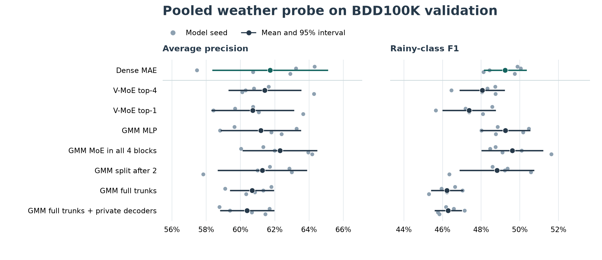

# M6.4.1 Pooled weather probe

Can a single linear readout separate rainy from clear images across all conditions? Use the same final encoder
checkpoints as [M6.4.0](M6.4.0-day-night-weather-probe.md), including the dense MAE, with one probe for all training
images per model seed. This measures how linearly accessible weather is in the pooled embedding space.

## Protocol

Fit on every `clear` or `rainy` image in the official BDD100K training split and evaluate on every image with either
label in the official validation split. Include all time-of-day and scene categories. The probe's training pool includes
eligible BDD images outside the filtered M6.3 encoder training cache. Both splits retain all eligible examples and the
validation split retains its natural class prevalence.

| BDD100K split | Clear | Rainy | Total |
| -- | -: | -: | -: |
| Train | 37,412 | 5,083 | 42,495 |
| Validation | 5,346 | 738 | 6,084 |

Use the unmasked, mean-pooled 96-dimensional embeddings from the final checkpoints at step 963. Learned MoEs use their
normal evaluation routing. GMM arms reuse the saved posteriors, and the dense control uses its shared encoder. As in
M6.4.0, the offline GMM was fit using the validation images as well as the training images.

Fit a feature standardizer and one L2-regularized logistic classifier (`C=1`) per checkpoint. Weight the two weather
classes equally in the training objective to match the emphasis of the balanced M6.4.0 probe fits. Use the default
classifier cutoff for accuracy, balanced accuracy and rainy F1. Report average precision (AP) and ROC AUC from its
continuous scores. The intervals are descriptive 95% Student-t intervals across five encoder seeds on the fixed
validation split.

## Results

Each row averages five final checkpoints. All scores are percentages.

| Architecture | Accuracy | Balanced accuracy | Rainy F1 | Average precision | ROC AUC |
| -- | -: | -: | -: | -: | -: |
| Dense MAE | 80.1 | 79.9 | 49.2 | 61.7 | 87.9 |
| V-MoE top-4 | 79.3 | 79.1 | 48.1 | 61.4 | 87.6 |
| V-MoE top-1 | 79.0 | 78.5 | 47.4 | 60.7 | 87.3 |
| GMM MLP | 80.2 | 79.7 | 49.2 | 61.2 | 87.6 |
| GMM split after two | 80.5 | 78.9 | 48.8 | 61.3 | 87.2 |
| GMM full trunks | 80.1 | 76.0 | 46.2 | 60.7 | 85.1 |
| GMM full trunks + private decoders | 80.0 | 76.2 | 46.3 | 60.4 | 85.1 |
| GMM MoE in all four blocks | 80.7 | 79.7 | 49.6 | 62.3 | 87.4 |

The validation split is 12.1% rainy. Always predicting clear would give 87.9% accuracy, 50% balanced accuracy, and zero
rainy F1. The class-balanced probes use their default cutoff and catch rainy images at the cost of extra false
positives. Average precision and ROC AUC show how the continuous scores rank images across cutoffs.



**Figure 1.** Small dots mark individual seeds. Large dots and bars show means and descriptive 95% intervals.

The all-block GMM had the highest mean average precision and rainy F1. Its seed-paired gains over dense were 0.6 points
in average precision (95% interval [−3.8, 5.0]) and 0.4 points in rainy F1 ([−1.6, 2.4]). Dense led on balanced accuracy
and ROC AUC. Both full-trunk variants scored about 2.9 points below dense in ROC AUC, with paired intervals below zero.

One linear direction separates rainy from clear images reasonably well across all eight architectures. The pooled probe
gives little evidence of an MoE advantage for this particular label. The geometry measured here is the linear
decodability of weather in the final embedding, and other features can have different geometry.

## Reproduction

```bash
OMP_NUM_THREADS=3 OPENBLAS_NUM_THREADS=1 VECLIB_MAXIMUM_THREADS=1 \
  .venv/bin/python -m scripts.run_pooled_weather_probe
```

```bash
MPLBACKEND=Agg .venv/bin/python -m scripts.plot_pooled_weather_probe
```

`outputs/m6_4_1/` records class counts, the exact split membership, source checkpoint hashes, and per-seed confusion
matrices and metrics. The runner reuses completed checkpoint evaluations when their protocol and checkpoint hashes
match.
